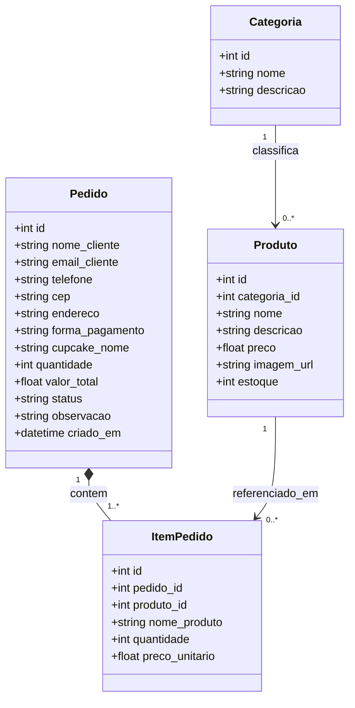
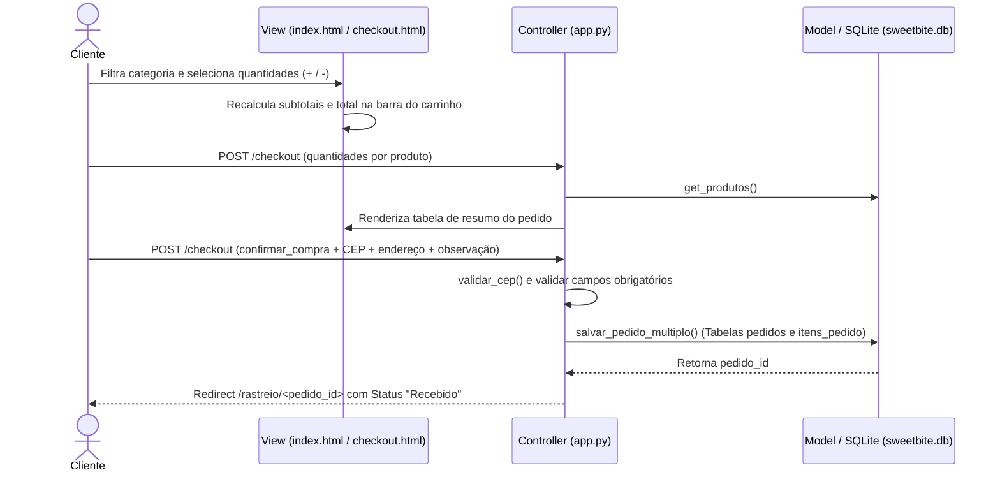

# Documentação de Engenharia de Software – SweetBite Gourmet (PIT II)

- **Estudante:** Gustavo Marques de Almeida
- **RGM:** 35691042
- **Curso:** Engenharia de Software – 7º Período
- **Disciplina:** Projeto Integrador Transdisciplinar em Engenharia de Software II (PIT II)

---

## 1. Revisão do Escopo e Melhoria Contínua (Kaizen sobre o PIT I)

No 6º Período (PIT I), realizou-se o levantamento de requisitos, histórias de usuário e backlog ágil (Scrum) para a confeitaria **SweetBite Gourmet**. No 7º Período (PIT II), aplicando a filosofia **Kaizen**, o planejamento foi revisado e expandido com as seguintes melhorias:
1. **Filtro dinâmico por categorias gourmet** (*Clássicos*, *Especiais* e *Veganos*);
2. **Seleção simultânea de múltiplas unidades** de diferentes sabores diretamente no catálogo com cálculo de subtotal em tempo real;
3. **Validação estruturada de CEP (8 dígitos)** e preservação dos dados do formulário em caso de falha de validação;
4. **Proteção contra submissão duplicada (clique duplo)** no checkout;
5. **Campo de instruções especiais / mensagem em cartão de presente**;
6. **Painel do Confeiteiro (`/admin/pedidos`)** com atualização do status do pedido em tempo real (*Recebido -> Em Produção -> Saiu para Entrega -> Entregue*).

---

## 2. Modelagem UML Atualizada

### 2.1 Diagrama de Classes de Persistência e Domínio

### 2.2 Diagrama de Sequência – Fluxo de Pedido Multi-Itens

---

## 3. Projeto de Interface Humano-Computador (IHC)

- **Design Responsivo Mobile-First:** Desenvolvido com HTML5, CSS3 e Bootstrap 5.
- **Prevenção de Erros e Feedback Visual:**
  - Botão de avanço ao checkout permanece desabilitado enquanto a quantidade total for zero;
  - Máscara automática de CEP (`00000-000`) e crítica visual imediata se o CEP não possuir 8 dígitos;
  - Bloqueio do botão de confirmação no primeiro clique (`⏳ Processando seu pedido...`);
  - Fechamento suave automático de alertas após 5 segundos.

---

## 4. Projeto Físico do Banco de Dados e Dicionário de Dados

O script físico DDL encontra-se em [`docs/schema.sql`](schema.sql).

### Dicionário de Dados

| Tabela | Coluna | Tipo | Restrição | Descrição |
| :--- | :--- | :--- | :--- | :--- |
| `categorias` | `id` | `INTEGER` | `PK, AUTOINCREMENT` | Identificador único da categoria |
| `categorias` | `nome` | `TEXT` | `NOT NULL, UNIQUE` | Nome da linha (*Clássicos*, *Especiais*, *Veganos*) |
| `categorias` | `descricao` | `TEXT` | `NULL` | Descrição comercial da categoria |
| `produtos` | `id` | `INTEGER` | `PK, AUTOINCREMENT` | Identificador único do cupcake |
| `produtos` | `categoria_id` | `INTEGER` | `FK -> categorias(id)` | Categoria à qual o cupcake pertence |
| `produtos` | `nome` | `TEXT` | `NOT NULL` | Nome do sabor gourmet |
| `produtos` | `descricao` | `TEXT` | `NOT NULL` | Descrição dos ingredientes e recheio |
| `produtos` | `preco` | `REAL` | `NOT NULL, >= 0` | Preço unitário em Reais (R$) |
| `produtos` | `imagem_url` | `TEXT` | `NULL` | URL da fotografia ilustrativa |
| `produtos` | `estoque` | `INTEGER` | `DEFAULT 20` | Saldo disponível em estoque |
| `pedidos` | `id` | `INTEGER` | `PK, AUTOINCREMENT` | Número rastreador do pedido |
| `pedidos` | `nome_cliente` | `TEXT` | `NOT NULL` | Nome completo do comprador |
| `pedidos` | `email_cliente` | `TEXT` | `NOT NULL` | E-mail de contato do comprador |
| `pedidos` | `telefone` | `TEXT` | `NOT NULL` | WhatsApp/Telefone do cliente |
| `pedidos` | `cep` | `TEXT` | `8 dígitos` | CEP do endereço de entrega |
| `pedidos` | `endereco` | `TEXT` | `NOT NULL` | Logradouro, número, complemento e bairro |
| `pedidos` | `forma_pagamento`| `TEXT` | `DEFAULT 'PIX'` | Meio de pagamento selecionado |
| `pedidos` | `cupcake_nome` | `TEXT` | `NOT NULL` | Resumo textual dos itens e quantidades |
| `pedidos` | `quantidade` | `INTEGER` | `NOT NULL, >= 1` | Soma total de unidades do pedido |
| `pedidos` | `valor_total` | `REAL` | `NOT NULL, >= 0` | Valor total calculado do pedido |
| `pedidos` | `status` | `TEXT` | `DEFAULT 'Recebido'`| Etapa atual (*Recebido, Em Produção, Saiu para Entrega, Entregue*) |
| `pedidos` | `observacao` | `TEXT` | `NULL` | Mensagem de presente ou restrição alimentar |
| `itens_pedido`| `id` | `INTEGER` | `PK, AUTOINCREMENT` | Identificador único do item do pedido |
| `itens_pedido`| `pedido_id` | `INTEGER` | `FK -> pedidos(id)` | Referência ao pedido principal |
| `itens_pedido`| `produto_id` | `INTEGER` | `FK -> produtos(id)` | Referência ao cupcake adquirido |
| `itens_pedido`| `quantidade` | `INTEGER` | `NOT NULL, >= 1` | Quantidade adquirida daquele sabor |
| `itens_pedido`| `preco_unitario`| `REAL` | `NOT NULL, >= 0` | Preço unitário praticado na venda |
